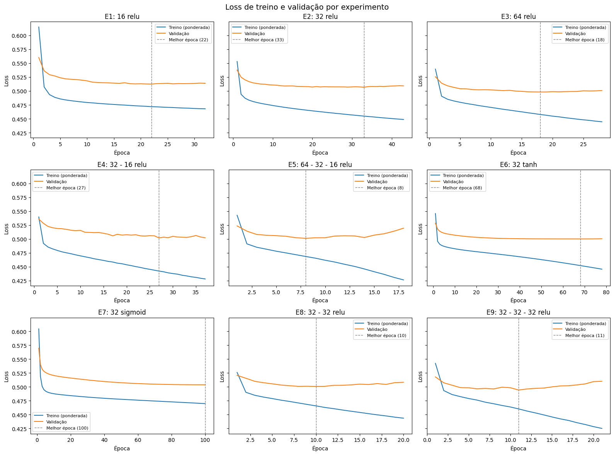
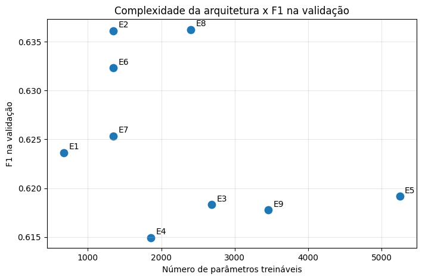
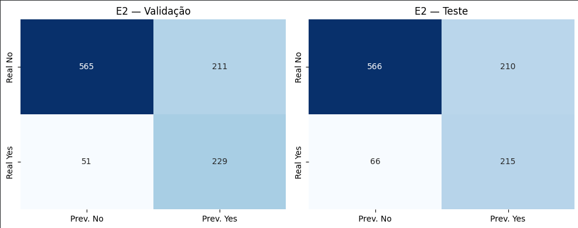

# CP2 – Previsão de Churn com Redes Neurais MLP

[](https://colab.research.google.com/github/Codebynaty/NOME_DO_REPO/blob/main/CP2_MLP_RN.ipynb)


Projeto prático do **Check Point 2** (FIAP, turma 2CCPA): classificação binária com **redes neurais multicamadas (MLP)** para prever o **cancelamento de clientes (churn)** de uma operadora de telecomunicações, usando a base *Telco Customer Churn*.

O trabalho compara 9 arquiteturas de MLP, variando **largura**, **profundidade** e **função de ativação** em condições controladas, e seleciona a de melhor equilíbrio entre desempenho, estabilidade e generalização.

## Sumário

- [Problema](#problema)
- [Base de dados](#base-de-dados)
- [Pré-processamento](#pré-processamento)
- [Metodologia](#metodologia)
- [Arquiteturas avaliadas](#arquiteturas-avaliadas)
- [Resultados](#resultados)
- [Modelo selecionado e teste final](#modelo-selecionado-e-teste-final)
- [Limitações](#limitações)
- [Como executar](#como-executar)
- [Estrutura do repositório](#estrutura-do-repositório)
- [Integrantes](#integrantes)
- [Referências](#referências)

## Problema

Prever, a partir de dados cadastrais, de serviços contratados e de cobrança, se um cliente vai cancelar o serviço.

- **Classe positiva (1):** `Churn = Yes` (o cliente cancelou)
- **Classe negativa (0):** `Churn = No` (o cliente permaneceu)

O erro mais grave é o **falso negativo**: um cliente que vai cancelar e não é identificado fica sem ação de retenção. Por isso a escolha do modelo não se baseou em acurácia, e sim em métricas da classe positiva (precisão, recall e F1).

## Base de dados

[Telco Customer Churn](https://www.kaggle.com/datasets/blastchar/telco-customer-churn), base de exemplo da IBM disponível no Kaggle. No notebook, o arquivo é carregado da [cópia pública da IBM](https://github.com/IBM/telco-customer-churn-on-icp4d), com upload manual do arquivo do Kaggle como alternativa.

| Item | Valor |
|------|-------|
| Clientes | 7.043 |
| Colunas | 21 (1 identificador, 19 variáveis explicativas e o target) |
| Churn = Yes | 1.869 (26,54%) |
| Churn = No | 5.174 (73,46%) |

As variáveis se dividem em **dados do cliente** (`gender`, `SeniorCitizen`, `Partner`, `Dependents`), **serviços contratados** (`PhoneService`, `InternetService`, `StreamingTV`, etc.) e **conta e cobrança** (`tenure`, `Contract`, `PaymentMethod`, `MonthlyCharges`, `TotalCharges`, etc.).

**Principais achados da EDA**

- O churn é muito maior em contratos mensais (42,7%) do que em contratos de um ano (11,3%) ou de dois anos (2,8%).
- Fibra óptica (41,9%) e pagamento por *electronic check* (45,3%) concentram mais cancelamentos.
- Quem cancela tem menor tempo de permanência (média de 18 meses, contra 37,6) e mensalidade mais alta (74,44 contra 61,27).
- Não há duplicatas nem outliers pelo critério do IQR. `TotalCharges` tinha 11 valores vazios (clientes com `tenure = 0`), preenchidos com 0.

## Pré-processamento

Todas as transformações foram **ajustadas somente no treino** (`fit_transform`) e apenas aplicadas na validação e no teste (`transform`), dentro de um `ColumnTransformer`:

| Grupo | Variáveis | Transformação |
|-------|-----------|---------------|
| Numéricas contínuas | `tenure`, `MonthlyCharges`, `TotalCharges` | `StandardScaler` |
| Binária | `SeniorCitizen` | mantida como 0/1 |
| Categóricas | 15 variáveis de texto | `OneHotEncoder(drop="if_binary", handle_unknown="ignore")` |

Após a transformação, a base passa de 19 para **40 features**. O `customerID` é removido.

**Desbalanceamento:** tratado com `class_weight="balanced"`, calculado só com `y_train` (0,681 para a classe 0 e 1,885 para a classe 1), igual em todos os experimentos.

## Metodologia

Divisão estratificada pelo target, feita **antes** de qualquer transformação:

| Conjunto | Amostras | % Churn | Uso |
|----------|---------:|--------:|-----|
| Treino | 4.930 | 26,53 | Ajuste dos pesos da rede e do pré-processamento |
| Validação | 1.056 | 26,52 | Comparação de arquiteturas e escolha do modelo |
| Teste | 1.057 | 26,58 | Avaliação final, usado uma única vez |

**Configuração fixa de treinamento (igual para todas as arquiteturas)**

| Parâmetro | Valor |
|-----------|-------|
| Saída | 1 neurônio, `sigmoid` |
| Perda | `binary_crossentropy` |
| Otimizador | Adam (taxa de aprendizado 0,001) |
| Épocas / batch | até 100 / 32 |
| Early stopping | `val_loss`, paciência 10, restaura melhor época |
| Limiar de decisão | 0,5 |
| Semente | 42 (com `enable_op_determinism`) |

**Regra de seleção (definida antes de olhar o teste):** maior F1 da classe positiva na validação; diferenças menores que 0,01 são empate; no empate, vence o modelo com menos parâmetros.

## Arquiteturas avaliadas

| ID | Objetivo | Camadas ocultas | Ativação | Parâmetros |
|----|----------|-----------------|----------|-----------:|
| E1 | Referência | 16 | ReLU | 673 |
| E2 | Largura | 32 | ReLU | 1.345 |
| E3 | Largura | 64 | ReLU | 2.689 |
| E4 | Profundidade | 32-16 | ReLU | 1.857 |
| E5 | Profundidade | 64-32-16 | ReLU | 5.249 |
| E6 | Ativação | 32 | tanh | 1.345 |
| E7 | Ativação | 32 | sigmoid | 1.345 |
| E8 | Profundidade isolada | 32-32 | ReLU | 2.401 |
| E9 | Profundidade isolada | 32-32-32 | ReLU | 3.457 |

## Resultados

Métricas da classe positiva (churn) na **validação**:

| ID | Arquitetura | Loss val. | Acurácia | Precisão | Recall | F1 | Gap F1 (treino − val.) |
|----|-------------|----------:|---------:|---------:|-------:|---:|-----------------------:|
| E1 | 16 ReLU | 0,512 | 0,735 | 0,500 | 0,829 | 0,624 | 0,014 |
| **E2** | **32 ReLU** | **0,507** | **0,752** | **0,520** | **0,818** | **0,636** | **0,018** |
| E3 | 64 ReLU | 0,498 | 0,736 | 0,501 | 0,807 | 0,618 | 0,033 |
| E4 | 32-16 ReLU | 0,502 | 0,746 | 0,514 | 0,764 | 0,615 | 0,045 |
| E5 | 64-32-16 ReLU | 0,501 | 0,737 | 0,502 | 0,807 | 0,619 | 0,033 |
| E6 | 32 tanh | 0,500 | 0,750 | 0,518 | 0,811 | 0,632 | 0,026 |
| E7 | 32 sigmoid | 0,504 | 0,737 | 0,502 | 0,829 | 0,625 | 0,014 |
| E8 | 32-32 ReLU | 0,501 | 0,751 | 0,519 | 0,821 | 0,636 | 0,014 |
| E9 | 32-32-32 ReLU | 0,494 | 0,743 | 0,510 | 0,782 | 0,618 | 0,038 |





**O que a comparação mostrou**

- **Largura:** de 16 para 32 neurônios o F1 subiu (0,624 → 0,636); com 64 não houve ganho e o gap treino-validação aumentou.
- **Profundidade:** mais camadas não ajudaram. Com 32 neurônios por camada, 2 camadas empataram com 1 (F1 0,636) usando quase o dobro de parâmetros, e 3 camadas pioraram (0,618). As redes mais profundas atingiram a melhor época cedo e depois a loss de validação voltou a subir.
- **Ativação:** ReLU (0,636) e tanh (0,632) praticamente empatadas, mas a tanh precisou de 78 épocas contra 43. A sigmoid ficou abaixo (0,625) e não convergiu em 100 épocas.
- **Overfitting/underfitting:** nenhum modelo teve overfitting forte (gaps de F1 abaixo de 0,05). Todas as arquiteturas ficaram entre 0,61 e 0,64 de F1, o que sugere que o limite está mais na informação disponível na base do que na capacidade da rede.

## Modelo selecionado e teste final

**E2: 1 camada oculta, 32 neurônios, ReLU (1.345 parâmetros).** Empatou no maior F1 de validação com a menor complexidade entre as empatadas, com gap baixo e recall alto.

Avaliação única no conjunto de teste, sem retreino e com limiar 0,5:

| Métrica | Validação | Teste | Diferença |
|---------|----------:|------:|----------:|
| Loss | 0,5069 | 0,4806 | −0,0262 |
| Acurácia | 0,7519 | 0,7389 | −0,0130 |
| Precisão | 0,5205 | 0,5059 | −0,0146 |
| Recall | 0,8179 | 0,7651 | −0,0527 |
| F1 | 0,6361 | 0,6091 | −0,0270 |

Matriz de confusão no teste: **VN = 566, FP = 210, FN = 66, VP = 215**.



Na prática, de cada 100 clientes que cancelam, o modelo identifica cerca de 77. Dos clientes sinalizados como risco, cerca de metade realmente cancelaria. Para uma ação de retenção essa troca é aceitável, pois perder um cliente custa mais do que contatar um que ficaria. O resultado foi consistente com a validação, indicando boa generalização.

## Limitações

- Uma única divisão dos dados, sem validação cruzada, e uma única semente. Diferenças de 0,01 a 0,02 no F1 entre arquiteturas estão dentro da variação esperada.
- Limiar de decisão fixo em 0,5, sem otimização.
- Precisão em torno de 0,5: metade das ações de retenção iria para clientes que não cancelariam.
- Redundância entre variáveis (`TotalCharges` ≈ `tenure` × `MonthlyCharges`, com correlação de 0,9996, e colunas "No internet service" após o one-hot).

## Como executar

### Google Colab (recomendado)

Clique no botão **Open in Colab** no topo e execute **Ambiente de execução → Executar tudo**. O dataset é baixado automaticamente.

### Localmente

```bash
git clone https://github.com/Codebynaty/NOME_DO_REPO.git
cd NOME_DO_REPO

python -m venv venv
source venv/bin/activate        # Linux/macOS
venv\Scripts\activate           # Windows

pip install -r requirements.txt
jupyter notebook CP2_MLP_RN.ipynb
```

Os experimentos originais foram executados no Colab com pandas 2.2.3, numpy 2.1.3, scikit-learn 1.6.1, TensorFlow 2.21.0 e Keras 3.13.2.

## Estrutura do repositório

```
.
├── CP2_MLP_RN.ipynb              # Notebook com os experimentos
├── Relatorio_CP2_MLP (1).docx    # Relatório completo
├── complexidade_vs_f1.png        # Figuras usadas no README
├── curvas_aprendizado.png
├── matriz_confusao_e2.png
├── requirements.txt
└── README.md
```

## Integrantes

- Ana Clara Alcântara
- Izabely dos Santos
- Natalia Alcântara

Turma 2CCPA, FIAP.

## Referências

- IBM. *Telco Customer Churn* (base de exemplo): https://github.com/IBM/telco-customer-churn-on-icp4d
- BLASTCHAR. *Telco Customer Churn*. Kaggle: https://www.kaggle.com/datasets/blastchar/telco-customer-churn
- PEDREGOSA, F. et al. Scikit-learn: Machine Learning in Python. *JMLR*, v. 12, p. 2825–2830, 2011.
- CHOLLET, F. et al. Keras: https://keras.io
- ABADI, M. et al. TensorFlow: https://www.tensorflow.org
